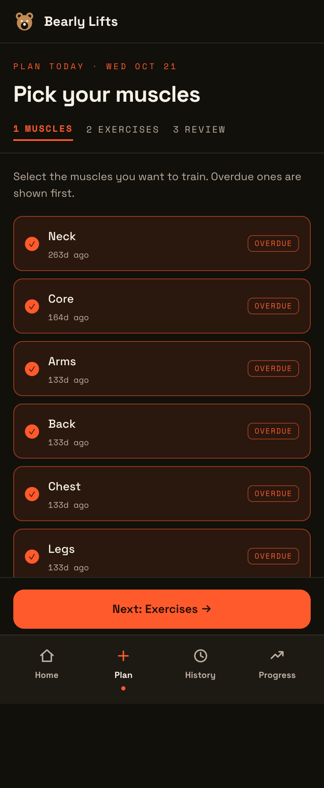
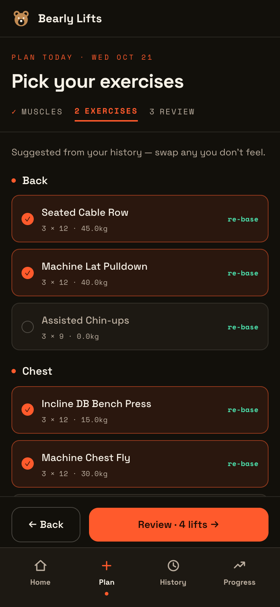
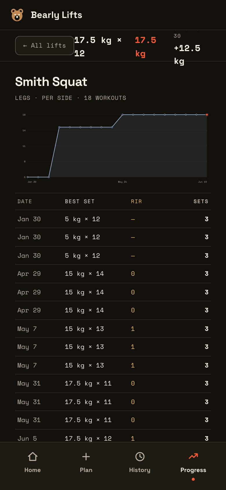

# Bearly Lifts

A Rails app that logs workouts, shows progress per lift, ranks the muscles you have neglected longest, and suggests the next weight.

<p>
  
  
  
</p>

## Run

```
docker compose -f docker-compose.dev.yml up -d
bin/setup
bin/rails db:seed
```

Log in with `dev@example.com` / `devdevdev`.

## Test

```
bin/ci
bin/rails test:system
```
